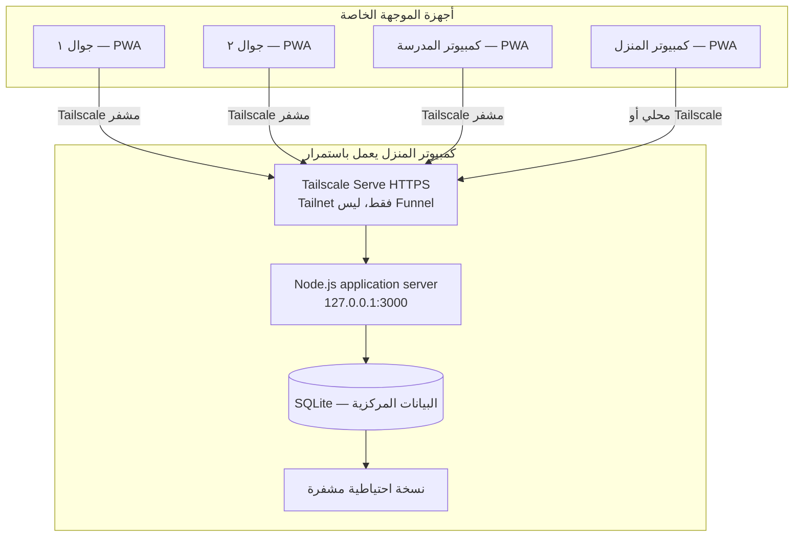

# التصميم التقني المعتمد للتجربة — المزامنة الخاصة لأربعة أجهزة
**التاريخ:** 2026-10-25  
**الحالة:** مواصفات معمارية وتجهيز فقط؛ لا يوجد خادم إنتاج عامل، ولا بيانات طالبات منقولة.

> هذه وثيقة تقنية عامة فقط. لا تحفظ أسماء الطالبات، أرقامهن أو أوصاف الحالات في GitHub أو سجلات التنفيذ.

## 1. النطاق الفعلي

- **المستخدمة:** الموجهة الطلابية وحدها، على جوالين وكمبيوتر المنزل وكمبيوتر المدرسة. الخادم نفسه كمبيوتر المنزل، أي **أربعة أجهزة مستخدمة إجمالًا** وليس أربعة أجهزة بالإضافة إلى خادم مستقل.
- **المدرستان:** الابتدائية ٣١ والمتوسطة ٣٤، مع فصل الوصول والبحث والإحصاءات والتقارير بحسب school_code. لا يُنسب سجل غير محدد المدرسة إلى إحداهما تلقائيًا.
- **العمل عبر الإنترنت:** نسخة واحدة موحدة، تعمل عند الوصول إلى الخادم عبر الشبكة الخاصة.
- **العمل دون إنترنت:** عرض وإدخال وتعديل محلي مشفّر، ثم رفع معلَّم بالإصدار ومراجعة التعارضات عند عودة الاتصال.
- **البيانات الحقيقية:** محظور ترحيلها أو تشغيلها قبل موافقة الجهة التعليمية على التطبيق المستقل والتخزين على أجهزة خاصة/خادم منزلي، وتوثيق سياسة الوصول والاحتفاظ.

## 2. المخطط العام



يستضيف الخادم واجهة **HTML/CSS/JS + API** من الأصل HTTPS الخاص بالشبكة المنزلية. لا تُفتح تطبيقات سجلات الطالبات من GitHub Pages العام عند التشغيل الحقيقي. يحتفظ GitHub بمصدر برمجي خالٍ من الأسرار والبيانات فقط.

## 3. المكونات والتشغيل

| جزء | اقتراح مبدئي | ملاحظة |
|---|---|---|
| نظام تشغيل الكمبيوتر المنزلي | Windows 10/11 مدعوم أو Linux | اختيار ملف الخدمة يحدد بعد معرفة نظام الجهاز |
| Backend | Node.js LTS + Fastify | عملية واحدة، ربط 127.0.0.1:3000 |
| Database | SQLite WAL + foreign keys + migrations | معاملات ذرية؛ كافٍ للمستخدمة الواحدة |
| Private network | Tailscale على الأجهزة الأربعة | ACL/Grants مقيدة للمنفذ 443 فقط |
| Reverse proxy | Tailscale Serve HTTPS | **ممنوع Tailscale Funnel** |
| Frontend | PWA مستقلة | Service Worker للموارد الثابتة فقط |
| Local cache | IndexedDB مشفر بمفتاح مشتق من عبارة مرور | لا يُخزن مفتاح فك التشفير بشكل مكشوف |
| Authentication | حساب منفرد بكلمة مرور قوية + عامل ثانٍ متى توفر | جلسات آمنة HttpOnly Secure SameSite=Strict |
| Backup | SQLite Online Backup API + نسخ مشفرة | نسخ مستقلة ولا يكتفى بمزامنة السجلات |
| Files | مخزن محلي داخل مجلد بيانات خارج المشروع | لاحقًا: مرفقات مع تشفير وضبط حجم وأنواع |

مثال *بعد تثبيت خدمة محلية وهمية وفحص السياسة* من PowerShell بوضع المدير:
```powershell
tailscale serve --bg 3000
tailscale serve status
```
المسار المقصود `http://127.0.0.1:3000` داخليًا، وHTTPS على اسم جهاز Tailscale فقط. تشغيل الأمر لا يُنشئ الخادم ولا قاعدة البيانات؛ وهو **ليس خطوة مطلوبة الآن** قبل اختبار الأمان.

في إعدادات Tailscale: تفعيل MagicDNS وHTTPS Certificates. اختر اسم جهاز غير حساس، لأن أسماء شهادات `*.ts.net` قد تُسجل في سجلات شهادات عامة. لا تفتح منفذًا في راوتر المنزل.

## 4. حدود الثقة والحماية

1. **طبقة الشبكة:** جهاز البيت ضمن Tailnet خاصة. السماح فقط لأجهزة الموجّهة الأربعة بالاتصال إلى خادم البيت على `tcp:443`. راجع سياسات المنع الافتراضية وألغِ أي allow-all قائم قبل تشغيل حقيقي. فعّل Device Approval أو ضوابط مماثلة إذا توفرت.
2. **طبقة التطبيق:** لا تعتمد على مجرد اتصال Tailscale. حساب الموجهة يسجل الدخول داخل التطبيق. لا يجوز أن تنتج الاستجابة السحابية بيانات عند غياب الجلسة أو عدم صلاحيتها.
3. **جلسات المتصفح:** كوكي جلسة HttpOnly + Secure + SameSite=Strict؛ جلسة قصيرة الأجل وقابلة للإلغاء من الخادم؛ حماية CSRF لطلبات التغيير إن لزم؛ CORS لا يسمح بأصول غير الأصل الخاص.
4. **البيانات المخزنة:** صلاحيات نظام ملفات مخصصة لخدمة الخادم، مع تشفير القرص مثل BitLocker في الإصدارات التي تدعمه، وتشفير مستقل للنسخ الاحتياطية. أمن الأجهزة وكلمة مرور نظام التشغيل وحدهما لا يحميان التخزين عند سرقة الجهاز أو إذا كان الحساب مفعلًا.
5. **الهواتف والأجهزة الثانوية:** لا تخزن نصوص السجلات الحساسة في Cache Storage أو سجلات المتصفح؛ تخزن في IndexedDB مشفر؛ يقفل العرض بعد مهلة عدم نشاط؛ امسح نسخة الجهاز عند إلغاء صلاحياته. ما زال هذا بحاجة إلى تنفيذ واختبار وليس ميزة موجودة.
6. **GitHub العام:** لا ترفع ملفات JSON الحقيقية أو SQLite أو `.env` أو صور المرفقات أو سجلات API؛ ملفات الإعداد والنماذج الوهمية فقط.
7. **التشغيل:** إلغاء وضع السكون في جهاز البيت، تشغيل خدمة الخادم عند الإقلاع، تحديثات أمنية، كهرباء مستقرة وUPS اختياري. إذا انقطع الكهرباء/الإنترنت تُؤجّل المزامنة دون مسح السجلات المحلية.

**قيد قانوني/إداري:** إبقاء قاعدة البيانات في المنزل لا يعني الموافقة تلقائيًا على استخدام أجهزة شخصية في معالجة بيانات الطالبات. كما أن خدمة Tailscale تستخدم خدمات هوية/تنسيق وربما مرحِّلات للاتصال؛ يلزم مراجعتها في سياسة البيانات قبل التشغيل.

## 5. مخطط البيانات والخلفية

تُنفذ migrations مرقمة، مع فهارس على `school_code` و`updated_sequence`:

| جدول | الحقول المهمة | الهدف |
|---|---|---|
| users | id, password_hash, mfa_enabled, active | مستخدمة واحدة |
| devices | id, label, authorized, last_seen | مراجعة/إبطال كل جهاز |
| students | id, school_code, full_name, grade, class_name, revision, deleted_at | ملف الطالبة |
| records | id, student_id?, school_code, category, payload_json, revision, deleted_at | جميع سجلات الموجهة |
| tasks | id, school_code, due_date, status, revision | المهام |
| attachments | id, record_id, file_ref, metadata, cipher_checksum | لاحقًا |
| changes | seq, entity, id, revision, operation, ts, device_id | موجز تغييرات للمزامنة |
| audit_log | id, entity, id_ref, before_json, after_json, actor, ts | حفظ تاريخ لا يمكن تغييره من الواجهة |
| import_batches | id, source_sha256, staged_count, verified_count, status | تتبّع الاستيراد |
| import_items | batch_id, source_section, source_id, source_hash, target_id | إعادة محاولة دون تكرار |

استخدم معرّفات UUID ثابتة للسجلات القديمة، ومفاتيح idempotency لكل عملية حتى لا يسبب انقطاع الشبكة تكرارًا.

**التوافق مع القديم:** ملفات `supabase-schema.sql` و `cloud.js` في المستودع عبارة عن إطار تجريبي **لا يستخدمه هذا التصميم**. يجب بناء `/api/v1` محلي واستخدام طبقة `PrivateSyncClient` بدل Supabase CloudClient. لا تحذف إطار التجربة حتى ينجح الانتقال.

## 6. مزامنة عملية ومقاومة للتعارض

- يُنشئ الجهاز أولًا تعديلًا في IndexedDB مشفّر، مع `mutation_id`, `record_id`, `base_revision`, `changed_fields`, `client_time`.
- ترسل الواجهة `POST /api/v1/sync/push` مع العمليات المعلقة. الخادم ينفذ كل عملية **داخل معاملة** إذا كانت `base_revision` تطابق `revision` الحالي، ويرفع رقم المراجعة ويسجل audit + changes.
- عندما يختلف الإصدار يرجع `409/conflict` بالبيانات/المراجعات اللازم مراجعتها، ولا يتخلص من تعديل الجهاز. خيار الاستبيان «آخر تعديل يحل محل السابق مع سجل التعديلات» يمكن تنفيذه **بعد عرض التعارض أو الموافقة على الاستبدال**، مع الحفاظ على النسختين في audit. لا تعتمد على ساعة الهاتف وحدها لترتيب التعديلات.
- يطلب الجهاز `GET /api/v1/sync/pull?since=<sequence>` ويرجع السجلات والتغييرات المرحلية فقط. يتم تطبيقها في معاملة IndexedDB دون إسقاط الطابور غير المرسل.
- إقرار الحفظ لا يظهر للمستخدمة إلا بعد إقرار الخادم بحفظ العملية. في الوضع غير المتصل يظهر **«محفوظ على هذا الجهاز — لم تتم المزامنة»** بوضوح.
- مزامنة عند فتح التطبيق، وعودة الإنترنت، والعودة إلى تبويب التطبيق، وأثناء بقائه مفتوحًا عند وجود تعديلات، وزر يدوي. لا نعتمد على Background Sync أثناء إغلاق التطبيق في iOS.
- الحذف المنطقي `deleted_at` مع سجل تدقيق؛ حذف نهائي يتم فقط وفق سياسة الاحتفاظ المعتمدة.

### واجهات الخادم

```text
GET   /healthz                # لا يكشف أي بيانات
POST  /api/v1/auth/login      # rate-limit + lockout
POST  /api/v1/auth/logout
GET   /api/v1/me
POST  /api/v1/sync/push
GET   /api/v1/sync/pull?since=<sequence>
GET   /api/v1/students?school=p31
GET   /api/v1/records?school=m34&category=health
GET   /api/v1/audit?entity=<id>
POST  /api/v1/import/stage    # بيانات وهمية فقط الآن
GET   /api/v1/import/<id>/report
POST  /api/v1/import/<id>/commit  # ممنوع للبيانات الحقيقية حتى الموافقة
POST  /api/v1/backups/verify  # إداري فقط
```

## 7. الاستيراد الآمن للنسخة السابقة

النسخة السابقة تضم **11 قسمًا**، ومعلومات ابتدائية ومتوسطة في ملف واحد. بعض الأسماء تتكرر وتوجد سجلات بأسماء متعددة، وأسماء بلا صف، لذلك:
1. نبدأ بالقراءة المحلية دون رفع أي بيانات. نظهر أعداد السجلات فقط.
2. نصنف المدرسة تلقائيًا عندما تكون المرحلة قطعية؛ الباقي يحتاج مراجعة سطرية.
3. نعزل السجلات ذات أكثر من اسم، ولا ننشئ لها هوية طالبة واحدة.
4. نحفظ `raw_data` الأصلي لكل سجل مع مؤشر القسم ومعرف السجل الأصلي وتجزئة SHA-256.
5. نقارن **عدد السجلات لكل قسم ولكل مدرسة** مع الأصل؛ نراجع أسماء/تواريخ وعينة موثقة بموافقة الجهة.
6. نطبّق على قاعدة تجريبية وهمية أولًا. الترحيل الحقيقي عملية لاحقة بعد اعتماد التخزين.
7. لا نلمس مستودع `student-guidance` القديم ولا نغير بيانات الجهاز المصدر. ولا نوقف الأصل إلا بعد مطابقة واختبار استعادة مستقل.

## 8. النسخ الاحتياطي والتعافي

- **يوميًا:** Snapshot متسق من SQLite Online Backup API (وليس نسخًا عاديًا لملف SQLite مفتوح في WAL).
- **أسبوعيًا:** نسخة مشفّرة ثانية على قرص خارجي منفصل *مصرح به*. نسخة أسبوعية وحدها لا تكفي ضد فقد آخر تعديلات الأسبوع.
- **التشفير:** خوارزمية معتمدة ومفتاح محفوظ خارج قاعدة البيانات ولا داخل GitHub.
- **التحقق:** فحص سلامة يومي، وتجربة استرجاع شهرية إلى قاعدة اختبار منفصلة، وتوثيق آخر نسخة نجحت استعادتها.
- **عطل الكمبيوتر:** الأجهزة تحتفظ بطابور التعديلات محليًا ولا تدعي أن البيانات «متزامنة»، ويستعاد الخادم من نسخة مستقلة ثم يرسل ما لم يصل من التعديلات وفق معرفاتها.

## 9. اختبارات قبول لازمة قبل الإنتاج

1. جهاز ١ يُدخل سجلًا وهميًا → يظهر على الأجهزة الأخرى بعد فتحها/المزامنة.
2. جهاز ٢ يحرر دون إنترنت → يظهر إشعار **«غير متزامن»** → يصل عند الاتصال.
3. جهازان يحرران السجل نفسه → يظهر تعارض ويُحفظ تاريخ النسختين ولا يختفي التعديل المحلي.
4. فصل الابتدائية والمتوسطة في البحث والتقارير والأرشيف.
5. منع أي اتصال من جهاز غير مصرح به؛ فشل تسجيل الدخول بلا كلمة مرور.
6. فك الاتصال بالمنزل أو إطفاء الخادم لا يؤدي لفقد السجلات المعلقة.
7. تشغيل الخادم مجددًا/إعادة تشغيل Windows يعيد الخدمة، بعد الاختبار.
8. النسخة الاحتياطية المشفرة تنجح في الاستعادة إلى قاعدة منفصلة.
9. فشل رفع دفعة استيراد منتصف النقل وإعادتها لا يضاعف عدد السجلات.
10. لا توجد بيانات أو مفاتيح سرية في GitHub أو GitHub Pages أو سجلات الأخطاء.

## 10. قرارات التنفيذ المعلّقة

- نظام تشغيل كمبيوتر المنزل، وهل هو Windows أم macOS أو Linux.
- هل يسمح مسؤولو البيانات المدرسية بتشغيل سجلات حقيقية على كمبيوتر منزلي وأجهزة شخصية وربطها عبر Tailscale؟ إن لم يسمحوا، يُسمح فقط بالبيانات الوهمية ويبقى النظام الجديد تجريبيًا.
- من يملك حساب Tailscale؟ الأفضل حساب منفصل خاص بالموجّهة، مع MFA وحصر الأجهزة.
- تحديد قرص النسخ الاحتياطي والقدرة على الاستعادة، ومكانه المسموح به.
- تجربة إمكانية اتصال كمبيوتر المدرسة بشبكة Tailscale دون مخالفة سياسة شبكة المدرسة.

## المصادر الفنية (مراجعة أكتوبر 2026)
- Tailscale Serve: https://tailscale.com/docs/features/tailscale-serve
- Serve CLI: https://tailscale.com/docs/reference/tailscale-cli/serve
- Tailscale grants: https://tailscale.com/docs/reference/syntax/grants
- HTTPS certificates: https://tailscale.com/docs/how-to/set-up-https-certificates
- Tailscale encryption & DERP: https://tailscale.com/docs/reference/connection-types
- Background Sync limits: https://developer.mozilla.org/en-US/docs/Web/API/Background_Synchronization_API
- نظام حماية البيانات الشخصية: https://dgp.sdaia.gov.sa/wps/portal/pdp/knowledgecenter/details/PDPL
